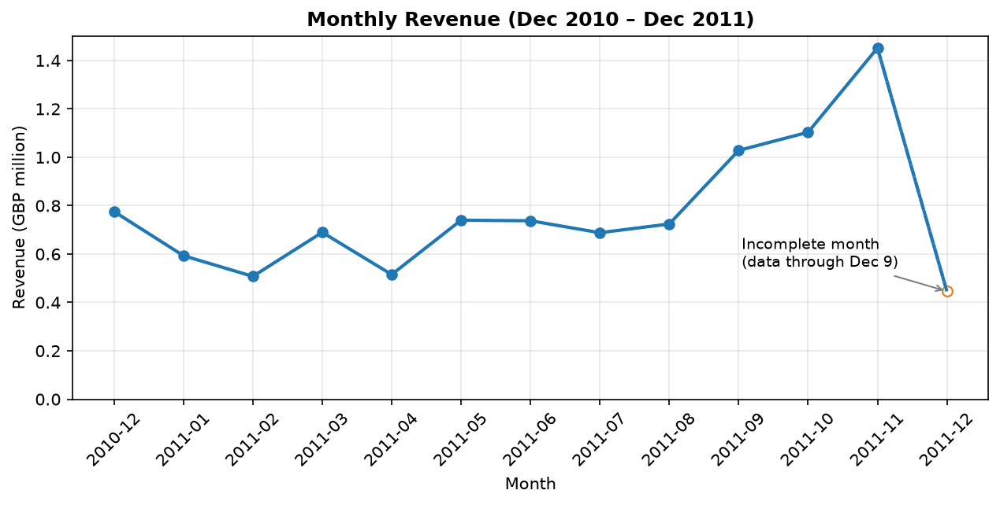
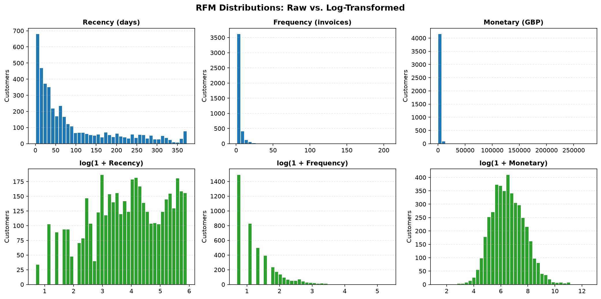
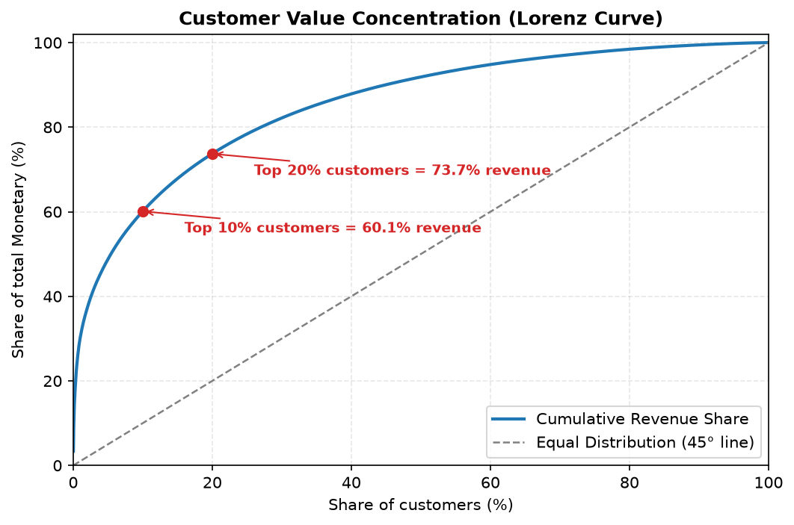

# Online Retail Analysis

An analysis of transaction data from a UK-based online store (Dec 2010 to Dec 2011), done in Python with pandas.

Status: work in progress. Data understanding, data cleaning, feature engineering (RFM) and exploratory analysis are done, customer segmentation is next.

## Background

The Online Retail dataset has over 540k transaction lines from a store that sells gift items, mostly to wholesalers. The raw data contains a lot of rows that are not regular sales (cancellations, stock adjustments, postage fees, bad debt entries), so it needs to be understood and cleaned before any real analysis.

## Business question

Who are the most valuable customers, who is at risk of leaving, and how should each group be treated? To answer this I segment customers with RFM (Recency, Frequency, Monetary) and K-Means.

## What I found so far

- 541,909 rows, 25,900 invoices, 4,372 customers and 38 countries. About 91% of the rows are from the United Kingdom.
- 24.9% of the rows have no `CustomerID`, and it isn't random (Hong Kong is missing it entirely).
- 10,624 rows have a negative `Quantity`. 9,288 are normal cancellations (`C` invoices) and 1,336 are internal stock adjustments (price 0, no customer).
- About 2,995 rows are not products (`POST`, `DOT`, `M`, `BANK CHARGES`, etc.), plus 3 "Adjust bad debt" rows of ±11,062.06.
- Two order-then-cancel pairs with huge quantities (±80,995 and ±74,215 units), and one 12,540-unit invoice at price 0 that moves the mean `Quantity` of StockCode 84826 from 29.9 to 359.1.
- The data ends on 9 Dec 2011, so December 2011 is incomplete.

The details and code are in [`notebooks/01_data_understanding.ipynb`](notebooks/01_data_understanding.ipynb).

## Cleaning result

Every raw row ends up in exactly one table ([`notebooks/02_data_cleaning.ipynb`](notebooks/02_data_cleaning.ipynb)):

| Table                                                                                                     | Rows    | Share  |
| --------------------------------------------------------------------------------------------------------- | ------- | ------ |
| `sales_clean`                                                                                           | 522,500 | 96.42% |
| `cancellations`                                                                                         | 9,286   | 1.71%  |
| `excluded_rows` (duplicates, non-product codes, stock adjustments, zero price, extreme pairs, bad debt) | 10,123  | 1.87%  |

The clean sales table has 19,771 invoices, 4,333 customers and 3,790 products, and covers about 10.0 million in revenue. About 25% of its rows (131,354) have no `CustomerID`, but they only make up about 15% of the revenue. They stay in the sales table and are left out of the RFM step. Every saved row keeps its raw row number in a `raw_index` column, so it can be traced back to the raw file.

## RFM table

[`notebooks/03_feature_engineering.ipynb`](notebooks/03_feature_engineering.ipynb) turns the clean sales into one row per customer:

| Column        | Meaning                                                                                                           |
| ------------- | ----------------------------------------------------------------------------------------------------------------- |
| `Recency`   | Days between the reference date (2011-12-10, one day after the last transaction) and the customer's last purchase |
| `Frequency` | Number of different invoices                                                                                      |
| `Monetary`  | Total spent on products, after subtracting the cancellations of real products                                     |

The final table has 4,320 customers. 13 customers were dropped because they returned everything they bought (a net Monetary of zero or less).

## Exploratory analysis

[`notebooks/04_eda.ipynb`](notebooks/04_eda.ipynb) explores the clean data with charts. The main points:

- Revenue peaks in November 2011 (1.45 million). December 2011 only looks low because the data stops on 9 December. Per active day it is almost the same as November.
- The UK brings in 84.77% of the revenue. No single product dominates: the top 10 bring in 8.22% of the revenue.
- Thursday is the busiest day, there are no invoices on Saturday, and about 78% of the invoices are made between 10:00 and 15:59.
- Recency, Frequency and Monetary are strongly skewed to the right, so I use a log transform before clustering.
- The value is concentrated: the top 10% of the customers bring in 60.1% of the Monetary value, and the bottom half only 8.1%.







## Repo structure

```
online-retail-analysis/
├── data/
│   ├── raw/             # put Online Retail.xlsx here (not tracked)
│   └── processed/       # created by notebooks 02 and 03 (not tracked)
├── notebooks/
│   ├── 01_data_understanding.ipynb
│   ├── 02_data_cleaning.ipynb
│   ├── 03_feature_engineering.ipynb
│   └── 04_eda.ipynb
├── reports/             # charts saved by notebook 04
├── requirements.txt
└── README.md
```

## How to run

1. Download the dataset from [UCI Online Retail](https://archive.ics.uci.edu/dataset/352/online+retail) and save it as `data/raw/Online Retail.xlsx`.
2. Create an environment and install the dependencies:
   ```bash
   python -m venv .venv
   # Windows: .venv\Scripts\activate    |  macOS/Linux: source .venv/bin/activate
   pip install -r requirements.txt
   ```
3. Run `jupyter lab` and run the notebooks in `notebooks/` in order. Notebook 02 creates the files in `data/processed/`, and notebooks 03 and 04 use them, so they have to run in order.

## Data source

Chen, D. (2015). Online Retail [Dataset]. UCI Machine Learning Repository. https://doi.org/10.24432/C5BW33

The dataset is not included in this repo. It is licensed under CC BY 4.0 by its creator.
